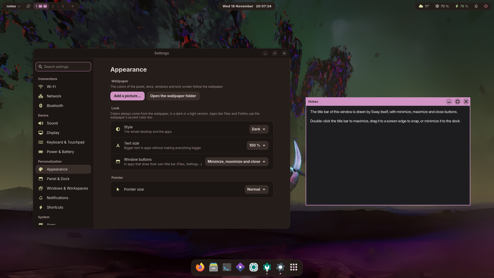
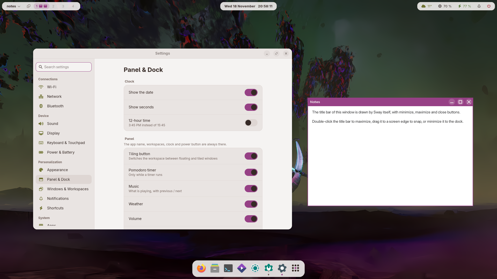
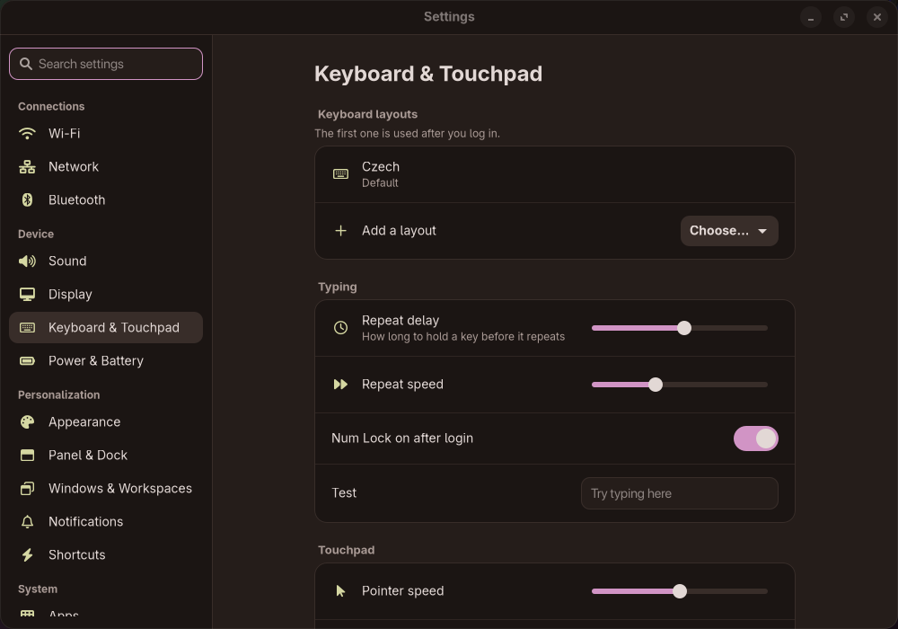

# Apogee

**A desktop shell for Sway**, written in Rust with GTK 4: top bar, dock, app grid, Spotlight-style
search, quick popups, notifications, a full Settings app and Wi-Fi password prompts. All of it
runs as **one program**.

*Apogee* is the highest point of an orbit. The shell sits on top of Sway and turns it into a
desktop that feels like GNOME or macOS, while Sway stays a normal, tiling-capable Sway underneath.



> **Status:** personal project, built and used daily on one laptop (Lenovo Legion Y520, Fedora 44,
> Sway 1.11). It works well there; elsewhere see [Requirements and limits](#requirements-and-limits).
> Code comments are in Czech; everything on screen is in English.

## What it does

| Part | What it does |
|---|---|
| **Top bar** | app name with a window menu, workspaces with app icons, clock, music, weather, tray, keyboard layout, volume, brightness, Wi-Fi, battery, updates, notifications, power |
| **Dock** | pinned and running apps; hides only when a window is in its way; minimized windows show as hollow dots |
| **App grid** and **Spotlight** (Super+Space) | apps, files (own index of the home folder), calculator, unit and currency conversion, system commands, web search |
| **Popups** under the bar | sound, brightness and night light, Wi-Fi, Bluetooth, battery, weather, calendar, media player, screenshots, screen recording, wallpapers, updates, Pomodoro; they open right under the icon you clicked |
| **Notifications** | popups, history, Do Not Disturb (also on a schedule), muted apps |
| **Settings** | 18 pages: Wi-Fi (incl. eduroam / WPA-Enterprise, not yet tried on a real eduroam network), Network (wired, VPN, hotspot), Bluetooth, Sound, Display, Keyboard & Touchpad, Power & Battery, Appearance, Panel & Dock, Windows & Workspaces, Notifications, Shortcuts, Apps, Date & Time, Users, Storage, Updates (incl. firmware), About |
| **Wi-Fi passwords** | NetworkManager secret agent: asks when a network needs a (new) password, like nm-applet |
| **Small things** | Alt+Tab switcher, volume / brightness OSD, clipboard history, power menu |

| Light style | Settings |
|---|---|
|  |  |

## How it works

- **One daemon, one small client.** `apogee-daemon` holds every window. `apogee <command>` only
  sends a line over a Unix socket (`$XDG_RUNTIME_DIR/apogee.sock`), so key bindings react
  instantly. If the daemon isn't running, the client starts it.
- **Event-driven, no polling.** Sway IPC events (windows, workspaces, input, ticks), D-Bus
  (NetworkManager, BlueZ, UPower, logind, MPRIS, notifications) and `pactl subscribe`.
- **Layer shell** (gtk4-layer-shell) for the bar, dock and popups; the Settings window is a
  normal window.
- **Colours** are read from `~/.config/theme/palette.json`, written by a wallpaper-based theme
  generator; `apogee style` reloads them live.
- **Sway settings** changed in the Settings app go to `~/.config/sway/settings.conf`, which the
  main Sway config includes last.
- **Things that need root** (battery conservation mode, time zone, password, firmware) go
  through `pkexec` / polkit dialogs. The one exception: installing system updates still opens a
  terminal window to show progress.

The numbers on the author's laptop (i5-7300HQ, 8 GB RAM): the whole desktop around Sway uses
57 MB of memory (PSS; it was 100 MB with waybar, mako, nwg-dock and scripts). Popups open in
about 45–50 ms; with the old Python and bash popups it was 180–360 ms. Speed means the time
from the command to the first screenshot that shows the popup, with `grim` in a loop. The
smoke test can repeat it (see [Testing](#testing)).

## Building and running

Needs Rust, GTK 4 (4.20+) and gtk4-layer-shell. On Fedora:

```bash
sudo dnf install rust cargo gtk4-devel gtk4-layer-shell-devel
cargo build --release
install -m755 target/release/apogee target/release/apogee-daemon ~/.local/bin/
```

In the Sway config:

```
exec ~/.config/sway/scripts/apogee-watch.sh      # or simply: exec ~/.local/bin/apogee daemon
bindsym $mod+space exec ~/.local/bin/apogee spotlight
bindsym $mod+x     exec ~/.local/bin/apogee dock
bindsym XF86AudioRaiseVolume exec ~/.local/bin/apogee osd vol-up
```

`apogee-watch.sh` (a small script from the author's setup, see below) restarts the daemon within a second if it ever crashes. It
runs inside the Sway session on purpose: as a systemd service the daemon would lose its logind
session, so `pkexec` and backlight control would stop working.

**Commands** (`apogee <command>`): `settings [page]`, `sound`, `brightness`, `wifi`, `bluetooth`,
`battery`, `weather`, `calendar`, `notifications`, `player`, `screenshot`, `recording`,
`wallpapers`, `updates`, `window`, `clipboard`, `power`, `dock`, `launcher`, `spotlight [text]`,
`alttab`, `alttab-back`, `osd vol-up|vol-down|vol-mute|brightness-up|brightness-down`,
`music previous|next|play-pause`, `screenshot-now area|window|screen`, `dnd [on|off]`, `style`.
The full list is at the top of [`src/klient.rs`](src/klient.rs).

**Files:** `~/.config/apogee/settings.json` (pinned apps, panel modules, clock, …),
`~/.cache/apogee/` (notification history, file index, update status, error log).

## Testing

```bash
bash tests/smoke.sh               # build, then test
bash tests/smoke.sh --no-build    # test the existing build
SWAY=/path/to/sway bash tests/smoke.sh   # against another Sway (e.g. one without the patch)
MEASURE_RUNS=20 bash tests/smoke.sh --no-build  # also measure how fast popups open, 20 runs each
```

The smoke test runs everything isolated: a headless Sway, the daemon, a private D-Bus session
bus and a copy of the config, all in a temporary `XDG_RUNTIME_DIR` and `HOME`. Your real session
is never touched. It opens every Settings page and popup and clicks the bar with a virtual
pointer. It answers a Wi-Fi password request with a virtual keyboard and checks the reply and
the dialog position. At the end it checks for crashes. Screenshots land in `tests/out/`.

## Requirements and limits

**Needed at runtime:** Sway, NetworkManager, PipeWire (with `pactl` / `wpctl`), BlueZ, UPower,
the *Font Awesome 6 Free* and *Adwaita Sans* fonts, `brightnessctl`, `grim` + `slurp`
(screenshots), `wf-recorder` (screen recording), `cliphist` (clipboard history), `gtklock`
(lock), `wlsunset` (night light) and `tuned` with its power-profiles interface (power modes).
**Optional:** `fwupd` (firmware updates), GNOME Calendar and Weather (links in the popups),
`blueman` (advanced Bluetooth).

**Set in the Settings app:** location for weather and night light (Date & Time → Location).
The backlight device is detected automatically. Lenovo battery conservation mode only shows up
when the `ideapad_acpi` driver offers it.

**Not part of this repository yet:** a few companion pieces that live in the author's (private)
dotfiles. Without them those features don't work:
- the wallpaper → colour theme generator (writes `~/.config/theme/palette.json` that Apogee reads;
  without it Apogee uses its built-in dark colours),
- small Sway scripts for night light, power modes and idle / lock times
  (`~/.config/sway/scripts/night-light.sh`, `power-mode.sh`, `idle.sh`),
- `apogee-watch.sh`, which restarts the daemon if it crashes.

**Sway patch:** the author runs Sway with a patch (not published) that adds title bar buttons,
maximize, snapping and minimize. With plain Sway everything else works (the smoke test checks
this); only those commands are unavailable.

**Code comments are in Czech**; names on screen, commands and documentation are English.

## Source map

| Path | Contents |
|---|---|
| `src/main.rs`, `src/klient.rs` | daemon and client |
| `src/lista/` | top bar and tray |
| `src/dok.rs`, `src/spoustec.rs` | dock and app grid |
| `src/spotlight/` | search, calculator, conversions, file index |
| `src/okenka/` | popups under the bar |
| `src/upozorneni/` | notification server |
| `src/nastaveni/` | Settings app (one file per page) |
| `src/hesla_site.rs` | NetworkManager secret agent |
| `src/sway.rs`, `src/styl.rs` | Sway IPC, theme CSS |
| `tests/` | smoke test and virtual input tools |
| `NAVRH-NASTAVENI.md` | Settings design notes (Czech) |

## Licence

[MIT](LICENSE) © 2026 Spartakusovec. Much of the code was written together with Claude (Anthropic).
